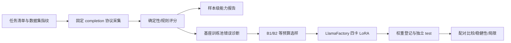

# 基座模型能力测量与评测驱动的 LightSFT 数据选择

用固定协议测量 Qwen3-8B-Base 的数学、泛化、知识/推理、指令遵循、代码和长上下文能力，再把基座在 GSM8K 训练池上的错误诊断转化为**等预算**的 SFT 数据选择：B1 按长度分层随机采样，B2 在同长度层内提高答错样本权重。主终点是 B2−B1 的 GSM8K 最终答案准确率差值，而不是任何合成分数。

**当前状态：工程实现与离线闭环；真实数据下载、四卡 LoRA、模型评测与人工复核尚未执行。不提供未经测量的提升数字，也不把本项目描述为预训练研究。**

## 项目目的

| 研究问题 | 可检验终点 | 不声称 |
|---|---|---|
| 怎样可靠测量基座能力？ | 每个任务的原生指标、样本级记录、固定 few-shot/提取/生成参数 | 不合成缺乏依据的总分，不把 LLM Judge 当主评分 |
| 基座错误能否指导数据选择？ | B2−B1 的 GSM8K test 准确率差值及配对 95%CI | 不预填收益，不把一次训练当稳定结论 |
| 选样收益能否迁移？ | SVAMP 冻结后的跨数据集结果 | SVAMP 不参与诊断、选样或调参 |
| 其他能力是否退化？ | MMLU-Pro、BBH、IFEval、HumanEval+、RULER 分任务变化 | 不用辅助任务反向挑选主结论 |

业务类比是“训练前数据预算分配”：同样 2,048 条样本、同样长度分布和 Token 预算，把样本花在基座当前答错的区域是否比随机更有效。真实公司数据、线上流量和预训练语料不在验证范围内。

## 架构与职责



这是轻量测量 Harness：管理数据版本、采集、评分、选样、训练配置和报告。它不实现预训练、不建 Web 平台、不做在线服务。上游源码固定在 `external/`，研究改动只在本仓库的薄适配与协议代码中。

```text
configs/        任务、模型标签、预算、选样与训练参数
prompts/        每个任务的固定系统提示；Judge 只做辅助错误分析
rubrics/        各任务原生指标、提取规则与“不合成总分”政策
src/foundation_eval/
  schema.py     任务/样本/响应/评分/权重契约
  data.py       固定 dev 留出、污染检查、长度分层、B1/B2 选样、SFT 导出
  agent.py      被测模型适配（completion/chat），不是 Agent
  judge.py      数学/选项/BBH/IFEval/代码/RULER 确定性评分与受限执行
  selection.py  B1/B2 产物、LlamaFactory 配置、权重登记
  report.py     原生指标、配对 CI、评测矩阵
  run.py        统一 CLI 与运行清单/冻结
scripts/        Windows 离线入口；Linux 安装/数据/服务/训练/评测/校验
data/fixtures/ 自制固定样例，仅用于工程验证
data/manifests/数据集清单、划分与冻结协议
runs/          自动实验产物，忽略 Git
docs/          实验、来源、贡献、JD 映射与项目状态
tests/         评分、隔离、选样、训练导出、报告与冻结检查
```

`agent.py` 保留与零售项目相同的位置和阅读顺序，但职责已替换为**被测模型适配**：没有工具、记忆、规划或子 Agent；只负责固定 prompt 拼接、completion/chat 请求、重试和 usage 记录。

## 快速开始（Windows 离线）

Python 3.12，PowerShell。命令在项目根目录执行。

```powershell
Set-Location C:\Users\33969\Documents\foundation-model-eval
py -3.12 -m venv .venv
$py = Join-Path $PWD '.venv\Scripts\python.exe'
& $py -m pip install -r requirements.lock.txt
& $py -m pip install --no-deps -e .
& $py -m pip check
& $py -m foundation_eval.run doctor
& $py -m foundation_eval.run check --offline
& $py -m pytest -q
& $py -m foundation_eval.run demo
```

或直接：

```powershell
scripts\windows\setup.ps1
scripts\windows\check.ps1
```

`demo` 只使用 8 条自制 GSM8K 风格样例和脚本响应，生成 `runs/<UTC>-demo-<id>/`：选样记录、逐样本响应/评分、`report/report.md`、`summary.json` 与诊断图。每处标记 scripted/no benchmark；不是模型结果。

## 实验步骤

### 1. Linux 环境与数据

```bash
bash scripts/linux/install.sh          # 基础/CPU 环境
bash scripts/linux/install_train.sh    # 独立 .venv-train
bash scripts/linux/install_infer.sh    # 独立 .venv-infer
bash scripts/linux/download_data.sh    # 数据指纹写入 data/manifests
```

数据下载后核对 `data/manifests/gsm8k.json` 的 fingerprint。GSM8K 官方 train 7473 题按 `SHA256("gsm8k-dev-v1:"+sample_id)` 排序，前 500 为 dev，余 6973 为训练池；官方 test 1319 只用于最终评测。

### 2. 基座诊断与 B1/B2 选样

先让 B0 在训练池上采集，并写出 `diagnosis.jsonl`：

```bash
python -m foundation_eval.run collect --task gsm8k --split train \
  --model-label B0 --protocol completion --diagnose-only \
  --samples data/processed/gsm8k/train.jsonl
# 把输出 run 的 diagnosis.jsonl 路径记为 $DIAG
python -m foundation_eval.run select \
  --pool data/processed/gsm8k/train.jsonl \
  --diagnosis "$DIAG" \
  --tokenizer Qwen/Qwen3-8B-Base \
  --output data/generated/selection
python -m foundation_eval.run train-export \
  --selection data/generated/selection \
  --output data/generated/training
```

`select` 会拒绝缺失诊断的池、超过 1% 的 Token 预算差、重复样本和少于登记数量的候选。输出 `selection.json` 记录每种子/组的样本 ID、Token、长度层、答错数量/比例与重叠数。B2 在相同长度层内把答错样本权重设为 3；权重只在层内生效。

### 3. 四卡 LoRA

```bash
MODEL=Qwen/Qwen3-8B-Base scripts/linux/serve_vllm.sh 8000   # B0 基线
bash scripts/linux/train_lora.sh configs/generated/b1_seed42_8b/seed42.yaml
bash scripts/linux/merge_lora.sh  configs/generated/b1_seed42_8b/seed42.yaml
```

训练设置固定为 BF16 LoRA：rank32 / alpha64 / dropout0.05 / lr 1e-4 / 全局 batch16（4 卡 × per-device 1 × 累积 4）/ 最大长度 4096 / 1 epoch；种子 42/43/44。数据、配置、日志、checkpoint 与选择依据都保留。先跑小步/数据加载检查，再跑完整矩阵。

### 4. 评测矩阵

每个被评模型单独起服务，把 `TARGET_MODEL` 设为其 served name，然后：

```bash
MODEL_LABEL=B1 TRAINING_SEED=42 scripts/linux/run_eval_matrix.sh
MODEL_LABEL=B2 TRAINING_SEED=42 scripts/linux/run_eval_matrix.sh
```

脚本先对每个任务冻结协议（任务、few-shot、提取、生成参数、数据/代码哈希），再跑 `test`。正式 test 不允许截断。RULER 是 4K/8K/16K × 3 任务的固定种子诊断，不是官方榜单。

```bash
python -m foundation_eval.run eval-matrix --runs runs/<...> --output runs/matrix
python -m foundation_eval.run compare \
  --a runs/<B1 seed42> runs/<B1 seed43> runs/<B1 seed44> \
  --b runs/<B2 seed42> runs/<B2 seed43> runs/<B2 seed44> \
  --output runs/comparison
bash scripts/linux/validate_results.sh
```

主比较只在同一任务、同一 test 划分、同一 completion 协议、同一冻结签名、完整记录的 run 之间进行；B1/B2 三个训练种子配对，样本级配对 Bootstrap 10000 次，报告每种子差值与 95%CI。SFT 模型的原生 chat 协议另表，不与 completion 合并。

### 5. 4B 复核

用 `Qwen/Qwen3-4B-Base` 重复 B0/B1/B2，只跑 GSM8K、SVAMP 和主要稳健性结果；不把 4B 结果与 8B 混池。

## 配置与预算

商业 API 的模型 ID、端点、价格和预算在 `.env` 与 `configs/experiment.yaml` 的 `budget` 中运行前填写。远程端点未设置 `budget.max_calls` 时 CLI 直接停止；实际调用数、Token、耗时写入运行清单。服务端不返回 usage 时记为未知，不补零或伪造价格。

## 产物位置

| 产物 | 位置 | 说明 |
|---|---|---|
| 数据集/划分/冻结 | `data/manifests/` | 指纹、样本 ID、协议签名 |
| 选样 | `data/generated/selection/` | 每种子 B1/B2 ID、Token、层分布、诊断 |
| 训练数据/配置 | `data/generated/training/`、`configs/generated/` | messages JSONL、LlamaFactory YAML、dataset_info |
| 采集 run | `runs/<UTC>-collect-<id>/` | manifest、samples、responses、scores、逐样本 raw |
| 报告 | `runs/<run>/report/` | 原生指标、状态对账、成本、失败案例、图 |
| 比较/矩阵 | `runs/comparison/`、`runs/matrix/` | 配对差值/CI、评测矩阵 |
| 权重 | `data/manifests/weights.jsonl` | 底座、adapter hash、数据/配置 hash、种子 |

原始输出不可覆盖；失败/中断 run 保留并标记 `interrupted`，修复后用新 run，不覆盖异常。`runs/`、`data/raw/`、`data/generated/`、checkpoint 和密钥默认不进入 Git。

## 当前状态

- 已实现/已验证：B1/B2 等预算选样、固定 dev 500 切分、污染检查、任务评分规则、代码受限执行入口、运行清单、冻结门禁、配对比较、评测矩阵、LlamaFactory 配置导出、Windows 离线闭环；测试见 `docs/STATE.md`。
- 待执行：真实 GSM8K/SVAMP 等数据下载与指纹、B0 训练池诊断、三次种子 × B1/B2 的 8B/4B LoRA、test 采集、人工失败案例复核、H20 结果校验。
- 非目标：预训练、在线服务、生产评测平台、多模态专项、把辅助任务合成为“总分”。

## 文档

| 内容 | 位置 |
|---|---|
| 实验设计、终点、统计与验收 | [EXPERIMENTS.md](docs/EXPERIMENTS.md) |
| 预注册模板（当前未填写） | [PREREGISTRATION.md](docs/PREREGISTRATION.md) |
| 上游来源、版本、许可与用途 | [REFERENCES.md](docs/REFERENCES.md)、[引用锁](references.lock.yaml) |
| 个人贡献与证据边界 | [CONTRIBUTIONS.md](docs/CONTRIBUTIONS.md) |
| 项目记忆、已验证事实与限制 | [STATE.md](docs/STATE.md) |
| JD 原文、来源清单与能力映射 | [JD_RAW.md](docs/JD_RAW.md)、[jd_sources.json](data/manifests/jd_sources.json)、[JD_ANALYSIS.md](docs/JD_ANALYSIS.md) |
| 下一步操作 | [NEXT_STEPS.md](docs/NEXT_STEPS.md) |

## 仓库与许可

公开仓库：[Josepheeeee/foundation-model-eval](https://github.com/Josepheeeee/foundation-model-eval)（`main`）。

本仓库代码为 MIT。`external/` 上游源码不随仓库分发，按 `references.lock.yaml` 固定 commit 获取；各上游保留自己的许可。数据集的许可与使用条款以官方数据集页为准，运行前复核。模型权重不随仓库分发。真实训练/评测产物默认不提交；公开时另行脱敏并保留失败记录。
